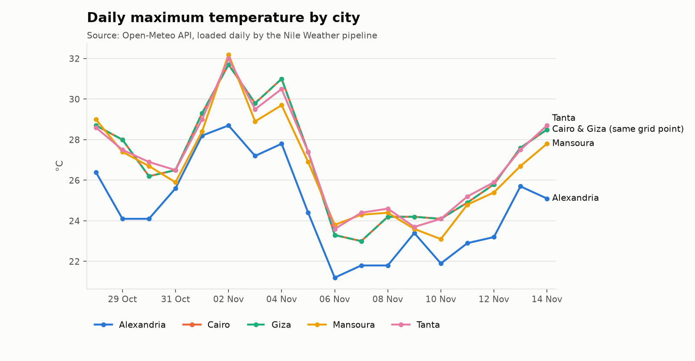
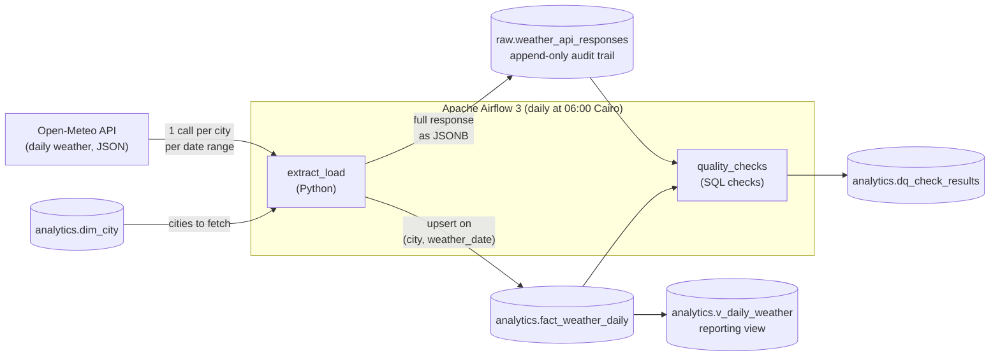

# Nile Weather Pipeline

> **Portfolio project.** Nile Basket is a fictional company. The weather data is real, from the free [Open-Meteo API](https://open-meteo.com/).

A daily batch pipeline that loads weather for 5 Egyptian cities into PostgreSQL, checks its quality, and runs on its own every morning with **Apache Airflow 3**. The whole stack starts with one command in **Docker Compose**.



## Problem

Nile Basket, an online store that delivers in Cairo, Giza, Alexandria, Mansoura and Tanta, wants to know whether **weather affects delivery delays and sales** in each city. Before anyone can answer that, they need a reliable daily weather table per city that:

- updates itself every day, without anyone running scripts by hand
- never double-counts a day, even when a run is retried or repeated
- fills in days that were missed (for example when the machine was off)
- warns when the data is incomplete or doesn't look right

## Architecture



| Layer | What it holds | Why |
| --- | --- | --- |
| `raw` | Every API response exactly as received, as JSONB | Evidence. If the transform has a bug, the data can be rebuilt from raw without calling the API again |
| `analytics` | A small **star schema**: `dim_city` and `fact_weather_daily`, plus a reporting view | Clean, typed tables for analysts and dashboards, ready to join with sales and delivery data later |

## Tech stack

| Purpose | Tool |
| --- | --- |
| Extraction and transformation | Python 3.12, requests, psycopg 3 |
| Storage | PostgreSQL 16 (JSONB for raw, typed tables for analytics) |
| Orchestration | Apache Airflow 3.3.1 (LocalExecutor) |
| Infrastructure | Docker, Docker Compose, a custom Airflow image |
| Testing | pytest (15 unit tests) |
| Chart | matplotlib |

## How to run

**Requirements:** Docker Desktop, and Python 3.12 for running scripts outside Docker.

```bash
# 1. Settings: copy the example file, then fill in a password and two random secrets
cp .env.example .env

# 2. Start everything: PostgreSQL + Airflow (the first build takes a few minutes)
docker compose up -d --build

# 3. Open Airflow at http://localhost:8080 and switch on the "nile_weather_daily" DAG
```

On the first start, PostgreSQL creates the initial schema from `sql/init`, and the `airflow-init` container applies the later schema changes from `sql/migrations`.

To run the steps by hand, outside Airflow:

```bash
python -m venv .venv && .venv\Scripts\activate   # Windows (use `source .venv/bin/activate` on Linux/macOS)
pip install -r requirements.txt

python -m pipeline.extract_load --start 2026-11-01 --end 2026-11-07   # load a date range
python -m pipeline.quality_checks                                      # check the last 7 days
python scripts/make_chart.py                                           # redraw docs/daily_max_temp.png
python -m pytest                                                       # run the tests
```

## How the DAG works

The DAG `nile_weather_daily` runs every day at **06:00 Cairo time** with two tasks:

```
extract_load  >>  quality_checks
```

1. **`extract_load`** loads **the day before the run's date**, the last full day. Each run always loads its own day, so re-running an old run reloads that same day.
2. **`quality_checks`** checks the last 7 days. It only runs if the load succeeded.

| Setting | Value | Why |
| --- | --- | --- |
| `catchup` | `True` | If the machine was off for a few days, the missed days run automatically |
| `max_active_runs` | `1` | Missed days run one at a time, in order, so the checks always see complete data |
| `retries` | 2, 5 minutes apart | A short API outage doesn't fail the day. The quality task has 0 retries: bad data won't fix itself |

## Design decisions

- **Idempotent loads.** The fact table's primary key is `(city, weather_date)`, and every load is an **upsert** (`INSERT ... ON CONFLICT DO UPDATE`). Retries, reruns and backfills can never create a duplicate. Verified: repeated manual runs plus a 4-day backfill left the fact table at exactly the same row count.
- **Raw and clean data written in one transaction**, so they always agree: both succeed or neither does.
- **One API call per city for a whole date range**, instead of one per day. A 90-day backfill for 5 cities is 5 calls, not 450.
- **Two levels of retries.** The code retries the API call on server errors, timeouts and HTTP 429 (Too Many Requests), with exponential backoff, and respects the `Retry-After` header. Other 4xx errors fail immediately, because retrying a wrong request doesn't help. Airflow then retries the whole task.
- **Fail loudly.** If the API returns different dates than requested, the run stops instead of loading data under the wrong date. Missing values stay `NULL`, never `0`.
- **The same command by hand or in Airflow.** Airflow runs `python -m pipeline.extract_load`, exactly like a person would. The pipeline code doesn't depend on Airflow, and the exit code tells Airflow whether a run failed.
- **Schema changes are migrations.** `sql/init` creates the first schema only once, when the database is new. Every later change is a numbered file in `sql/migrations`, applied exactly once by `python -m pipeline.migrate`, which records what it applied in a `schema_migrations` table.
- **No secrets in the code or in Git.** Everything comes from `.env` through environment variables.

## Data quality

`quality_checks` runs one SQL query per check. A query returns the **problem rows**: no rows means the check passed.

| Check | Severity | What it catches |
| --- | --- | --- |
| `completeness` | error | A city is missing a day in the window (a **gap**) |
| `freshness` | error | The newest day in the table is older than expected |
| `valid_ranges` | error | Values that are physically implausible for Egypt, or `temp_min_c` above `temp_max_c` |
| `missing_values` | warning | A measure is `NULL` because the API had no value |
| `sudden_jumps` | warning | Max temperature changed by more than 15 °C from one day to the next |
| `shared_grid_point` | warning | Two cities get their weather from the same API grid point |

- An **error** fails the task, so the run shows red in Airflow.
- A **warning** is logged, but the run still succeeds. It's for known, accepted issues.
- Every result is stored in `analytics.dq_check_results`, so quality can be tracked over time.

### A real data issue this caught

On the first load, Cairo and Giza had **exactly the same values every day**. The raw JSONB showed why: the API snapped both cities to the same grid point (30.02866, 31.219194), because they are only about 4 km apart. It's not a bug in the pipeline. It's the **spatial resolution** of the source. The `shared_grid_point` check now flags it on every run, as a warning.

## Data dictionary

**`analytics.fact_weather_daily`**: one row per city per day (the **grain**).

| Column | Type | Meaning | Source field |
| --- | --- | --- | --- |
| `city` | text | City name, foreign key to `dim_city` | |
| `weather_date` | date | The day, as a **Cairo local** calendar day | `daily.time` |
| `temp_max_c` | numeric | Maximum air temperature at 2 m, °C | `temperature_2m_max` |
| `temp_min_c` | numeric | Minimum air temperature at 2 m, °C | `temperature_2m_min` |
| `precipitation_mm` | numeric | Total precipitation for the day, mm | `precipitation_sum` |
| `wind_max_kmh` | numeric | Maximum wind speed at 10 m, km/h | `wind_speed_10m_max` |
| `loaded_at` | timestamptz | When this row was last written | pipeline |

**`analytics.dim_city`**: the cities Nile Basket delivers to, with `latitude` and `longitude`. Adding a city means adding a row here, with no code change.

**`analytics.v_daily_weather`**: the fact table joined to `dim_city`, plus derived columns:

| Column | Rule |
| --- | --- |
| `temp_range_c` | `temp_max_c - temp_min_c` |
| `is_rainy_day` | precipitation of at least 1 mm |
| `is_hot_day` | max temperature of at least 40 °C |
| `is_weekend` | Friday or Saturday (the weekend in Egypt) |

**`raw.weather_api_responses`**: one row per API call: `city`, `start_date`, `end_date`, `source_url`, the full `payload` (JSONB) and `fetched_at`.

**`analytics.dq_check_results`**: one row per check per run: the window, `check_name`, `severity`, `passed`, `failing_rows` and `details`.

## Runbook

| Situation | What to do |
| --- | --- |
| **Start or stop everything** | Open or quit Docker Desktop. The containers restart on their own (`restart: unless-stopped`) |
| **`extract_load` failed** | Open the task's **Logs** in Airflow. Usually the API was unreachable: Airflow already retried twice. Fix the cause, then **Clear** the task to rerun it |
| **`quality_checks` failed** | The log lists every problem row, for example `Tanta is missing 2026-11-09`. Reload the missing day with a backfill, then clear the task |
| **Reload a date range** | `docker exec -it nile_airflow_scheduler airflow backfill create --dag-id nile_weather_daily --from-date 2026-11-01 --to-date 2026-11-08` |
| **Add a city** | `INSERT INTO analytics.dim_city VALUES ('Aswan', 24.0889, 32.8998);`, then backfill the days you need. Watch the `shared_grid_point` warning for cities close to an existing one |
| **Change the schema** | Add the next numbered file to `sql/migrations`, then run `python -m pipeline.migrate` (or restart, and `airflow-init` applies it) |
| **Reset everything** | `docker compose down -v` deletes **all data**, then `docker compose up -d`. Reload the history with a backfill |

## Known limitations

- **Cairo and Giza share one weather grid point**, so their values are identical. The data can't tell them apart.
- **The API keeps about 92 days of past data**, so older days can't be backfilled from this endpoint.
- **It runs on one machine.** If the machine is off at 06:00, the run happens when Docker starts again (`catchup`).
- **The raw layer grows forever.** A production version would need a retention policy, for example archiving raw responses older than 90 days.
- **The fact table uses the city name as a natural key.** A production version would use a surrogate key (`city_id`), so renaming a city doesn't break history.
- **The Airflow UI has no login**, which is fine locally only.

## Project structure

```
dags/nile_weather_daily.py       the Airflow DAG: extract_load >> quality_checks
pipeline/extract_load.py         extract from the API, load raw + upsert the fact table
pipeline/quality_checks.py       the data quality checks
pipeline/migrate.py              applies sql/migrations exactly once each
sql/init/                        initial schema, runs once when the database is created
sql/migrations/                  every later schema change, numbered
scripts/make_chart.py            draws docs/daily_max_temp.png from the database
tests/                           unit tests for the transform, retry and check logic
docker-compose.yml               PostgreSQL + Airflow (init, api-server, scheduler, dag-processor)
Dockerfile                       the Airflow image with the pipeline's extra libraries
```

## Next steps

- Load Nile Basket's sales and delivery data into new fact tables that share `dim_city` and a new `dim_date`
- Alerts on failure (email or Slack) with an Airflow failure callback
- Move the SQL transformations and checks to **dbt**
